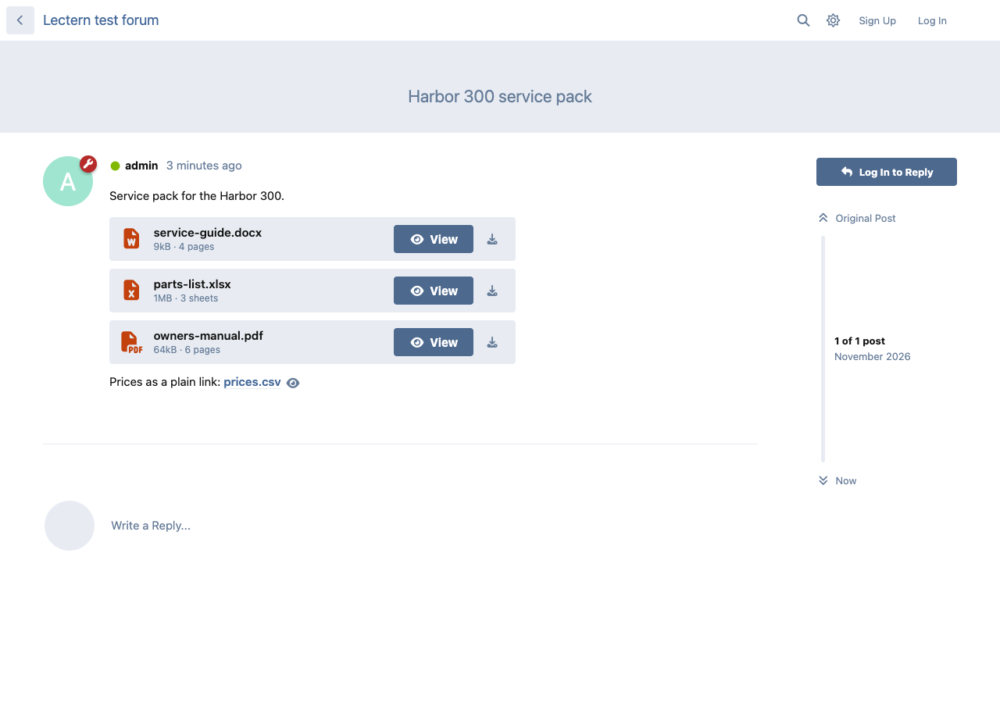
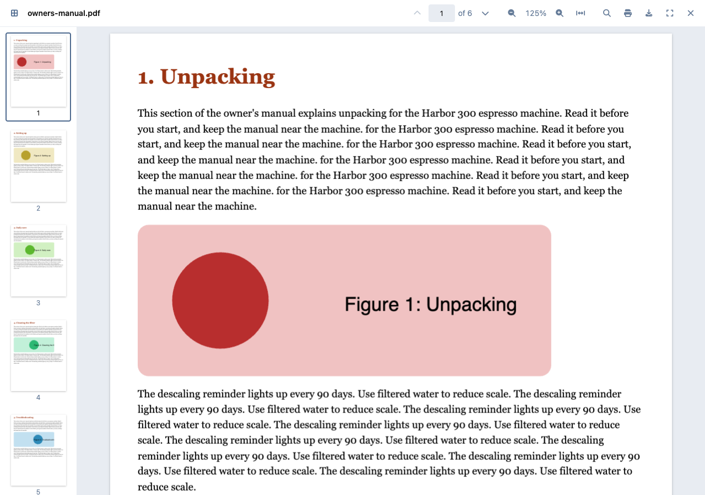
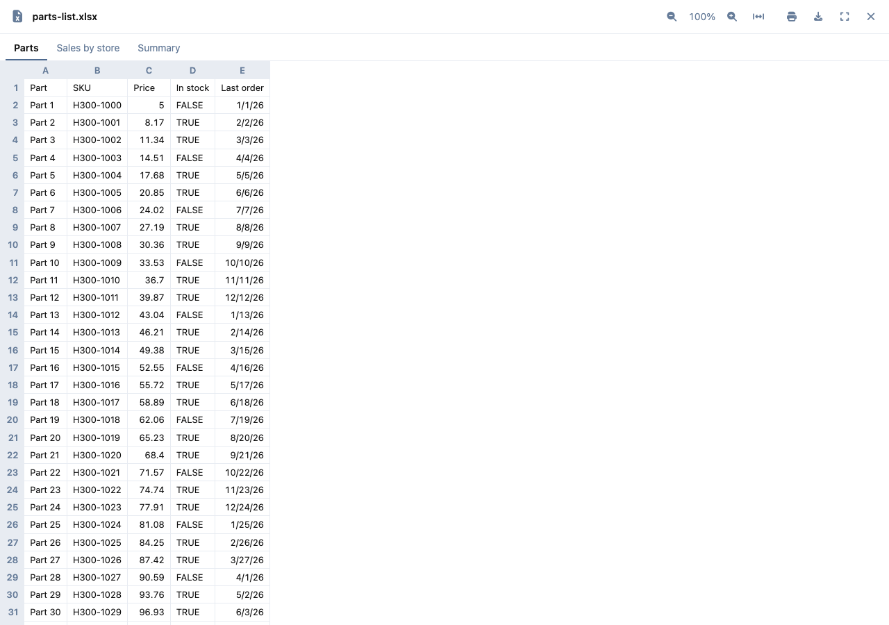
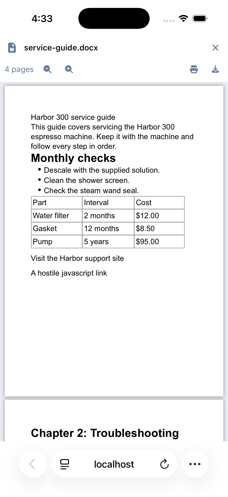
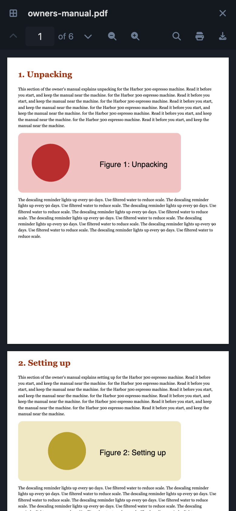

# Lectern

 [](https://packagist.org/packages/ernestdefoe/lectern)

A [Flarum](https://flarum.org) 2 extension that lets readers open PDFs, Word documents and spreadsheets right inside the post, so they don't have to download them first.



- **PDFs**: page thumbnails, search with highlighted matches, zoom, page navigation, print, download and full screen.
- **Word documents (.docx)**: the pages as Word lays them out, with zoom, print and download.
- **Spreadsheets (.xlsx, .xlsm, .xls, .ods, .csv)**: every sheet as a tab, with row and column headings that stay in view, merged cells, zoom, print and download.
- **Works with FoF Upload**: every PDF, Word file and spreadsheet uploaded with [FoF Upload](https://github.com/FriendsOfFlarum/upload) gets a **View** button, including files posted before Lectern was installed. The new **Document card** template shows the file as a card with its name, size and page or sheet count.
- **Works with plain links** to these files on your own forum, from any editor: Markdown, BBCode or a rich text editor.
- **Works in [Link Robins Wiki](https://github.com/linkrobins/flarum-wiki)** articles, their FAQ answers and comments, as well as in posts.
- **Phones**: pinch to zoom, swipe sideways to turn a PDF page, and a full-screen viewer that sits above the Mobile Tab bar. The back gesture closes it.
- **Keyboard and screen readers**: every control is labelled, pages and search results are announced, and the keys you would expect work (Page Up/Down, arrows, Home/End, +, −, 0, Ctrl+F, Escape).

| | |
|---|---|
|  |  |
|  |  |

## Light by design

The viewers load **only when someone opens a file**: pdf.js (Mozilla) for PDFs, docx-preview for Word and SheetJS for spreadsheets, each on its own. A page without an open file carries about 4 KB (gzipped) more than it did without Lectern, makes no extra requests, and the forum runs no extra queries. Page and sheet counts are worked out once, while FoF Upload takes the file.

## Private by design

- **Files never leave your forum.** No Google or Microsoft viewers, no CDN, no third-party calls. Every library, worker, font and decoder is served from your own forum.
- **Only your own files.** Links to files on other sites stay normal links.
- **FoF Upload's permissions apply.** Files are fetched through FoF Upload's own download address, with the reader's own session, so its download permission (and per-tag download permission) decides who can view a file. Readers who can't download a file don't get a View button.
- **Nothing in a file runs.** PDF scripts, forms and link actions are never run. Word documents render in a sandboxed frame with no scripts and a content security policy that blocks every outside request; embedded HTML is not rendered, and only web, email and in-document links are kept. Spreadsheet cells are shown as plain text.

## Installation

```sh
composer require ernestdefoe/lectern
php flarum migrate
php flarum cache:clear
```

## Updating

```sh
composer update ernestdefoe/lectern
php flarum migrate
php flarum cache:clear
```

Clearing the cache also publishes the new pdf.js files when an update brings them.

## Settings

- **Show documents in posts**: turn the View buttons on or off.
- **File types**: PDF, Word documents and spreadsheets, each on or off.
- **Open documents**: full screen, or in the post under the file. Phones always get full screen.
- **Permissions → View documents in posts**: which groups get the viewers. Everyone else keeps the normal link. Everyone has it after installing.

For the card on new uploads, open FoF Upload's settings and choose **Document card (Lectern)** as the template for `application/pdf`, the Word type (`application/vnd.openxmlformats-officedocument.wordprocessingml.document`) and the spreadsheet types you allow.

## Not in this version

PowerPoint previews and the older binary Word format (.doc).

## Links

- [GitHub](https://github.com/ernestdefoe/lectern)
- [Packagist](https://packagist.org/packages/ernestdefoe/lectern)

☕ If you like the things I have built, consider [buying me a coffee](https://buymeacoffee.com/ernestdefoe).

pdf.js is © Mozilla and contributors (Apache License 2.0, see `assets/pdfjs-*/LICENSE`), docx-preview © Volodymyr Baydalka (Apache License 2.0), SheetJS Community Edition © SheetJS LLC (Apache License 2.0), JSZip © Stuart Knightley and contributors (MIT).
